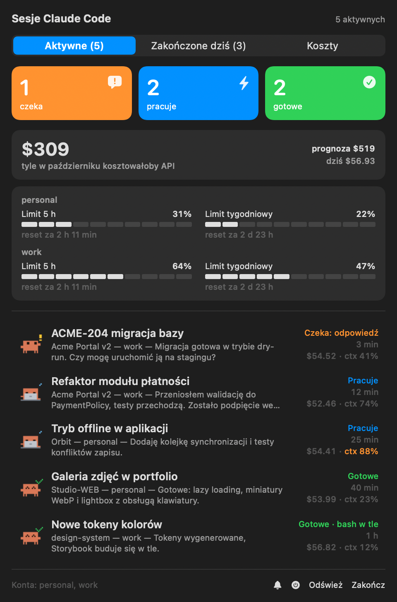
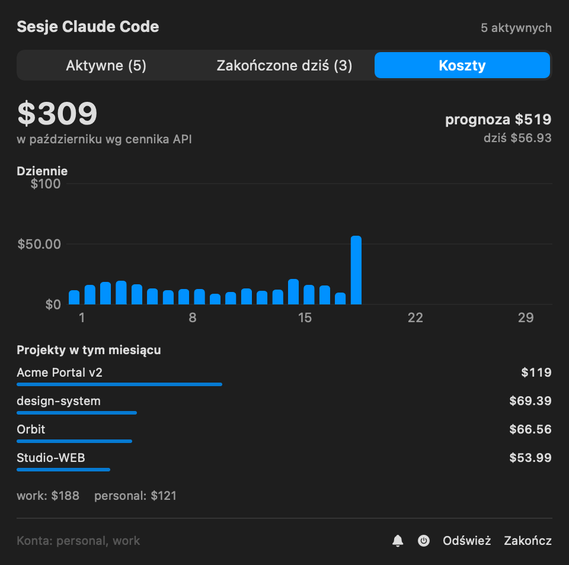
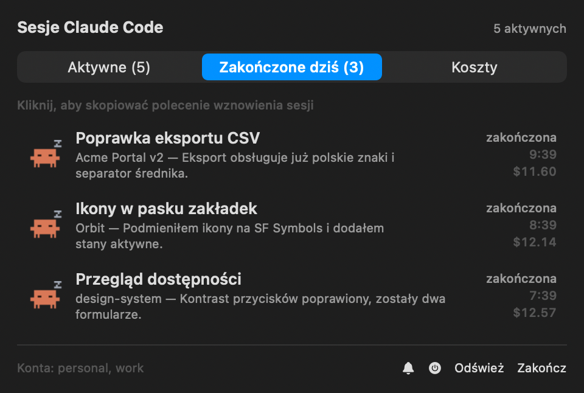

# Claude Tracker

A native macOS menu bar app and desktop widget for people who run many
[Claude Code](https://docs.claude.com/en/docs/claude-code) sessions at once. See at a glance
which sessions are **waiting for you**, which are **working** and which are **done**, read each
session's last answer, keep an eye on your rate limits and API-equivalent cost, get notified when
something needs you, and jump straight to the session's terminal tab.

Everything runs locally. The app never connects to the network.

<p align="center">
  
</p>

<p align="center">
  
  
</p>

> The interface is in Polish for now ("czeka" = waiting, "pracuje" = working, "gotowe" = done).
> All data in the screenshots is invented.

## Features

- **Menu bar**: waiting / working / done counters. The panel lists every live session with an
  animated mascot, its title, last answer, cost and context usage.
- **Tabs**:
  - active sessions;
  - sessions finished today (click copies a `claude --resume` command);
  - monthly costs (daily chart, top projects, month-end projection).
- **Notifications**: "✅ finished", "⏳ needs your input", and rate limit alerts at 80 % / 90 %.
  Clicking one takes you to the session.
- **Jump to the terminal**: click a session to bring its terminal tab to the front.
  - **Warp**: includes the hotkey (Quake) window.
  - **iTerm2** and **Terminal.app**: switch to the exact tab.
- **Desktop widget** in small, medium and large sizes.
- **Several accounts**: every `~/.claude` and `~/.claude-*` directory (for example
  `~/.claude-work`) and `CLAUDE_CONFIG_DIR` are picked up automatically.
- **Stall hints**: a session that has been working for 15 minutes without writing anything is
  flagged.

## Requirements

- macOS 14 or later (developed on macOS 26).
- Full Xcode with Swift 6. The Command Line Tools alone lack the SDK needed for WidgetKit.
- Claude Code 2.1 or later (the app reads its session files).
- Your shell does not matter (zsh, bash, fish…). See [Terminals](#terminals) for what the click does.

## Install

```bash
git clone https://github.com/somfink/macos-claude-tracker.git
cd macos-claude-tracker
scripts/bundle.sh --install            # builds dist/Claude Tracker.app and copies it to ~/Applications
open ~/Applications/Claude\ Tracker.app
```

The app has no window and no Dock icon. Look for the crab in the menu bar.

### Code signing

`bundle.sh` signs the app with the first "Apple Development" certificate in your keychain. Any Apple
ID can create one for free: Xcode → Settings → Accounts → add your Apple ID → Manage Certificates →
"+" → Apple Development.

- Without a certificate (`SIGN_IDENTITY=-`, ad-hoc signing), the app still works, but:
  - **there is no widget**, because WidgetKit needs a Team ID;
  - macOS asks for the Accessibility permission again after every rebuild.
- The Team ID and the App Group (`<TeamID>.dev.claude-tracker`) are read from your certificate at
  build time. None of it is stored in the repository.

### One-time permissions

| Permission | Why | Where |
|---|---|---|
| Notifications | finished / needs input / limit alerts | asked on first launch; later System Settings → Notifications → Claude Tracker |
| Accessibility | switching Warp tabs | asked on the first click on a Warp session; System Settings → Privacy & Security → Accessibility |
| Automation | switching iTerm2 / Terminal tabs | asked on the first click on such a session; System Settings → Privacy & Security → Automation |
| Login Items | start at login (⏻ in the panel footer) | System Settings → General → Login Items |

When macOS blocks the notifications, an orange button in the panel footer takes you to the right
settings page. Right-click the bell to send a test notification.

### Rate limits (optional)

Claude Code only hands the 5-hour and weekly limits to the statusline command. A tiny "tap" saves
that JSON locally so the app can read it. The installer adds one line to your existing statusline
script:

```bash
scripts/install-statusline-tap.sh              # dry run: shows the change, touches nothing
scripts/install-statusline-tap.sh --apply      # adds the line after `input=$(cat)`, keeps a *.bak-claude-tracker copy
scripts/install-statusline-tap.sh --uninstall  # removes it, keeps a *.bak-claude-tracker-uninstall copy
```

It needs a `statusLine` command in `settings.json` that reads the JSON from stdin. Without the tap
the panel shows a hint instead of the limits; everything else works.

## Terminals

Tracking, notifications, costs and the widget read Claude Code's files, so they work no matter
which terminal or shell you use. Only the click that jumps to a session depends on the terminal.
The app walks up from the session's process to the app it runs in:

| Terminal | What a click does |
|---|---|
| **Warp** | Shows Warp's window (sending your hotkey-window shortcut if you use one) and walks the tabs with "Tab → Switch to Next Tab" until the window title matches. A tab Claude Code has not retitled is matched by its project folder. |
| **iTerm2**, **Terminal.app** | Selects the tab whose tty belongs to the session, via AppleScript. |
| Anything else (Ghostty, kitty, VS Code…) | Brings the app to the front. |

The Warp hotkey is synthesized with US/ANSI key codes; another keyboard layout may need a different
key.

## Configuration

There are no API keys, tokens or `.env` files to set up. The few knobs:

| Variable | Used by | Meaning |
|---|---|---|
| `SIGN_IDENTITY` | `scripts/bundle.sh` | certificate name to sign with; `-` for ad-hoc (no widget) |
| `CLAUDE_CONFIG_DIR` | the app | an extra Claude Code config directory to watch |
| `CLAUDE_TRACKER_SNAPSHOT`, `CLAUDE_TRACKER_SNAPSHOT_TAB`, `CLAUDE_TRACKER_SNAPSHOT_HOME`, `CLAUDE_TRACKER_ICON` | development only | render the panel or the icon to a PNG and exit |

Accounts (`personal`, `work`, …) are simply the `~/.claude-<account>` directory names. The resume
command assumes a `claude-<account>` launcher (an alias or script that sets `CLAUDE_CONFIG_DIR`), and
plain `claude` for `~/.claude`.

## Privacy and security

- **Nothing leaves your Mac.** There is no network code.
- **Reads**:
  - `~/.claude*/sessions/*.json`;
  - transcripts under `~/.claude*/projects/` (cost, title, last answer);
  - Warp's preferences (its hotkey).
- **Writes** to `~/Library/Application Support/ClaudeTracker/`:
  - `usage-ledger.json`: per-message id, day, model, cost and project path;
  - `unread.json`;
  - `limit-alerts.json`;
  - `statusline/`: what the tap saved.

  No conversation text is stored on disk.
- **The widget** receives session titles, project names, statuses, limits and costs through its
  App Group container.
- **Notifications** show the start of the last answer, so it also appears in Notification Center
  history.
- **The `claudetracker://` URL scheme**: `session/<id>` jumps to an existing session and
  `test-notification` posts a sample banner. Any app or web page can open these links; neither can
  run a command.
- **The resume command** copied to the clipboard quotes the path and only accepts plain-token
  session ids and account names (`[A-Za-z0-9._-]`).

## Limitations

- `sessions/*.json` is an internal Claude Code format and may change between CLI versions.
- Costs are estimates at API list prices (no batch discounts or custom agreements). On a Pro or Max
  plan you do not pay these amounts; treat them as a usage measure.
- The widget refreshes at most once a minute (WidgetKit budget).
- Two Warp tabs with the exact same title can confuse the tab search.

## Uninstall

```bash
scripts/install-statusline-tap.sh --uninstall   # if you installed the tap
rm -rf ~/Applications/Claude\ Tracker.app ~/Library/Application\ Support/ClaudeTracker
```

## Development

```bash
swift test                                    # TrackerCore tests
swift build && .build/debug/ClaudeTracker     # without the bundle: no notifications, widget or login item
scripts/make-screenshots.sh                   # re-renders docs/screenshots from invented demo data
scripts/make-icon.sh                          # regenerates Resources/AppIcon.icns from the mascot sprite
```

- `Sources/TrackerCore`: everything without UI (parsing, statuses, costs, limits, terminal and tab
  matching), covered by tests.
- `Sources/ClaudeTracker`: the SwiftUI/AppKit app (menu bar, notifications, terminals, widget feed).
- `Widget/`: the WidgetKit extension. SwiftPM cannot build app extensions, so `scripts/bundle.sh`
  compiles it with `swiftc` together with the TrackerCore sources.

### Manual test checklist

1. The menu bar icon shows the counters; clicking it opens the panel with animated mascots.
2. A session finishes a turn → blue dot and a "✅" notification. Clicking the row or the
   notification jumps to the session's tab and closes the panel.
3. A session asks for permission → "waiting" tile and a "⏳" notification.
4. After `install-statusline-tap.sh --apply` and a statusline refresh → limit bars in the panel.
5. Edit Widgets → "Claude Tracker"; clicking a session in the widget jumps to it.

## License

MIT, see [LICENSE](LICENSE).
